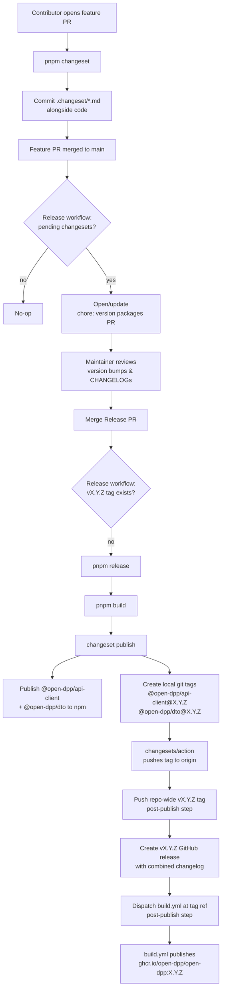
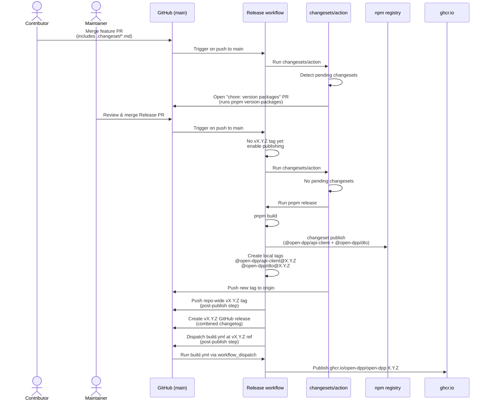

# Releasing

This document describes how releases are created in the `open-dpp` monorepo.

## Overview

Releases are managed with [Changesets](https://github.com/changesets/changesets). Every `@open-dpp/*` workspace package is version-locked via the `fixed` group in [`.changeset/config.json`](./.changeset/config.json), so all packages always share the same version number. [`@open-dpp/dto`](./packages/dto/package.json) and [`@open-dpp/api-client`](./packages/api-client/package.json) are published to npm. Every other workspace (apps and packages) is marked `private: true` and participates in the version bump only to keep internal `workspace:*` references consistent.

> **Publishing guardrail:** `.changeset/config.json` sets `"access": "restricted"` as the default for all packages. `@open-dpp/api-client` and `@open-dpp/dto` opt back in to public publishing via their own `publishConfig.access: "public"`. This means any _new_ scoped package added without an explicit `publishConfig` will fail to publish (on a free npm plan) instead of being silently published to the public registry — a safety net against accidentally shipping a package that forgot to set `"private": true`. If you add a new package that _should_ be public, set `publishConfig.access: "public"` in its `package.json` explicitly.

The flow is fully automated through [`.github/workflows/release.yml`](./.github/workflows/release.yml):

1. Contributors add a **changeset** file to any PR that changes a workspace package (see [When you need a changeset](#when-you-need-a-changeset)). For Renovate PRs, a bot adds it (see [Renovate dependency updates](#renovate-dependency-updates)).
2. When such a PR is merged to `main`, the release workflow opens (or updates) a **"chore: version packages"** PR that bumps versions and updates changelogs.
3. When a maintainer merges that PR, the workflow publishes `@open-dpp/api-client` and `@open-dpp/dto` to npm, pushes git tags, and creates one `vX.Y.Z` GitHub release with the combined changelog.



## When you need a changeset

Every PR that changes a workspace package needs one. In practice that means any PR touching `apps/main/`, `apps/client/`, `packages/*`, or `docs/`. The `changeset` job in [`build.yml`](./.github/workflows/build.yml) enforces it by running `changeset status --since=origin/main` on each pull request, so a change can no longer merge and silently miss the release.

Two escape hatches, and no others:

- **`pnpm changeset --empty`** — for a change that touches a workspace package but has nothing to tell users (refactors, tests, internal cleanups). It satisfies the CI job, is consumed by `changeset version` without bumping anything, and leaves a record in the PR that the omission was deliberate.
- **Changing nothing inside a workspace package** — root configuration, `.github/`, `Dockerfile`, `Makefile`, and top-level Markdown live outside every package, so `changeset status` has nothing to report and the job passes on its own. The same holds for `apps/e2e/`, which is listed in `ignore` in [`.changeset/config.json`](./.changeset/config.json) because it is never released.

`changeset` is a required status check on the `main` ruleset. The job does not run for the `changeset-release/main` PR, which consumes changesets rather than adding them, for PRs opened by `renovate[bot]`, or for PRs labelled `dependencies`. A skipped job counts as passing, so these PRs stay mergeable. The Renovate exemption keys on the PR author, not on whoever pushed last, so it holds when a maintainer or the changeset bot pushes to a Renovate PR. Renovate PRs that need a changeset get one from the bot (see [Renovate dependency updates](#renovate-dependency-updates)).

If in doubt, add a real changeset — an unnecessary one only produces a no-op changelog entry.

## Adding a changeset to your PR (contributor flow)

From the repo root:

```bash
pnpm changeset
```

Then follow the interactive prompts:

1. **Select the bumped package(s).** In practice, select `@open-dpp/api-client`. Because of the `fixed` group, every other `@open-dpp/*` package (including `@open-dpp/dto`) will bump along with it automatically — you don't need to tick them manually.
2. **Pick the bump type** using semver:
   - `patch` — bug fixes and internal changes that don't affect the public API.
   - `minor` — backwards-compatible new features or additions to the public API.
   - `major` — breaking changes to the public API.
3. **Write a summary.** This becomes the `CHANGELOG.md` entry end users will read, so write it for them — describe _what changed_ and _why it matters_, not the implementation details.

Changesets will generate a file at `.changeset/<random-name>.md`. **Commit it with your code changes.** Because `commit: false` is set in `.changeset/config.json`, Changesets does not commit the file for you.

Example changeset file:

```markdown
---
"@open-dpp/api-client": minor
---

Add `listProducts` endpoint for fetching a paginated list of products.
```

## Renovate dependency updates

Renovate cannot write changesets, so the [`Renovate changeset`](./.github/workflows/renovate-changeset.yml) workflow writes them instead. On every push to a PR opened by `renovate[bot]`, it runs [`.github/scripts/renovate-changeset.mjs`](./.github/scripts/renovate-changeset.mjs). The script compares each workspace package's `dependencies` and `peerDependencies` with the merge-base of `main`, ignoring internal `@open-dpp/*` references. If anything changed, it commits a patch changeset `.changeset/renovate-<pr>.md` that lists each change:

```markdown
---
"@open-dpp/api-client": patch
---

Update runtime dependencies:

- @open-dpp/api-client: `axios` ^1.18.0 → ^1.20.0
```

- **Which PRs get one:** PRs that change the runtime dependencies of a published package (`@open-dpp/dto`, `@open-dpp/api-client`). PRs labelled `security` also get one for private packages such as `apps/main` and `apps/client`, so the fix reaches a versioned Docker image with the next release. PRs that change only `devDependencies` or the lockfile get none. Nor do PRs that change only private packages without the `security` label. Those updates ship with the next release that has a changeset.
- **Why a patch:** the `fixed` group releases every `@open-dpp/*` package together. Changesets pile up in the version PR until a maintainer merges it, so a Renovate changeset does not mean one release per PR.
- **Kept in sync:** the file is rewritten on every push and deleted when the PR no longer qualifies. Each PR writes its own file, so Renovate PRs never conflict with each other.
- **CI and rebasing:** the bot pushes with a GitHub App token, so CI (build, test, e2e) runs on its commit. A push made with `GITHUB_TOKEN` would start no workflow runs. `gitIgnoredAuthors` in [`renovate.json5`](./renovate.json5) tells Renovate to ignore the bot's commits, so Renovate keeps rebasing the PR. Renovate's rebases drop the bot commit, and the workflow adds it again.
- **No install:** the job holds a write token and does not run `pnpm install`, so the install scripts of the updated dependency never run there. The script uses Node built-ins only. Its tests run in the `lint` job of [`build.yml`](./.github/workflows/build.yml) (`node --test ".github/scripts/*.test.mjs"`).

The workflow is skipped until the GitHub App is set up (see [Setting up the changeset bot](#setting-up-the-changeset-bot)).

## What happens on merge to `main` (automated flow)

The [`Release`](./.github/workflows/release.yml) workflow runs on every push to `main` and uses [`changesets/action`](https://github.com/changesets/action) to decide what to do:

- **If there are pending `.changeset/*.md` files:** the workflow opens (or updates) a PR titled **"chore: version packages"**. That PR runs `pnpm version-packages` (i.e. `changeset version`), which:
  - Consumes the pending changeset files and deletes them.
  - Bumps every `@open-dpp/*` package to the next version in lock-step.
  - Regenerates `CHANGELOG.md` for each package using [`.changeset/changelog.cjs`](./.changeset/changelog.cjs): the `@changesets/changelog-github` formatter, which links back to the PRs and contributors, minus its "Updated dependencies" entries. Those entries only restate that the `fixed` group moved every package to the same version.
- **If the current version has no `v<version>` tag yet** (the merged version PR): the workflow publishes. See [Cutting a release](#cutting-a-release-maintainer-flow).
- **Otherwise:** the workflow is a no-op.

The workflow publishes only while `@open-dpp/api-client`'s version has no repo-wide `v<version>` tag on `origin`. The `fixed` group moves every version together, and the publishing run pushes that tag (see [Docker images](#docker-images)). Every later push leaves the `publish` input of `changesets/action` empty, so `changeset publish` does not run. Otherwise a push that closely follows a release would fail: npm can report a new version as missing for a few minutes after publishing it, so `changeset publish` would try to publish it again and fail with `E409 Cannot publish over previously staged version`. Release runs are serialized, so the next run already sees the tag.

A publish that fails (for example during an npm outage) pushes no tag, so the next push to `main` retries it. So does a version PR merge whose Release run was cancelled while it waited behind another run (GitHub keeps only one pending run per concurrency group). To retry without waiting for a push, re-run the failed Release run.



## Cutting a release (maintainer flow)

1. Open the **"chore: version packages"** PR in GitHub.
2. Review:
   - The version bumps are what you expect (check that the `fixed` group bumped everything consistently).
   - The generated `CHANGELOG.md` entries read well for end users.
3. Merge the PR into `main`.
4. On that merge, the release workflow runs again. This time it detects that the new version has no `v<version>` tag yet and that no changesets are pending, and executes `pnpm release`, which runs:
   ```bash
   pnpm build && changeset publish
   ```
   `changeset publish` publishes `@open-dpp/api-client` and `@open-dpp/dto` to npm (using the `publishConfig.access: "public"` from each package's `package.json`) and creates local git tags `@open-dpp/api-client@<version>` and `@open-dpp/dto@<version>`. All private packages are skipped automatically. `changesets/action` then pushes the new tags to `origin` as part of its post-publish step (no manual `git push --tags` needed in CI).
5. Verify the release:
   - New per-package tags `@open-dpp/api-client@<version>` and `@open-dpp/dto@<version>` appear on [GitHub](https://github.com/open-dpp/open-dpp/tags). Changesets creates these.
   - A new repo-wide `v<version>` tag also appears — see [Docker images](#docker-images) below.
   - A single [GitHub release](https://github.com/open-dpp/open-dpp/releases) `v<version>` appears — see [GitHub release](#github-release) below.
   - The new version appears on [npmjs.com/package/@open-dpp/api-client](https://www.npmjs.com/package/@open-dpp/api-client) and [npmjs.com/package/@open-dpp/dto](https://www.npmjs.com/package/@open-dpp/dto).
   - A new Docker image is published to [`ghcr.io/open-dpp/open-dpp:<version>`](https://github.com/open-dpp/open-dpp/pkgs/container/open-dpp).

## GitHub release

Each version gets one GitHub release named `v<version>`, not one per published package. `changesets/action` runs with `createGithubReleases: false`, and a post-publish step in `release.yml` creates the release from the output of [`scripts/release-notes.mjs`](./scripts/release-notes.mjs). The script collects the `## <version>` section from every workspace `CHANGELOG.md` (all of `apps/`, `packages/` and `docs/`, except packages in the changeset `ignore` list), merges them under Major / Minor / Patch, and lists a changeset that targeted several packages only once. Notes from private packages such as `@open-dpp/main` and `@open-dpp/client` are included.

To preview the notes for a version locally:

```bash
node scripts/release-notes.mjs 6.3.3
```

If you run the manual / local release escape hatch, create the release yourself after pushing the `v<version>` tag:

```bash
node scripts/release-notes.mjs "$version" | gh release create "v$version" --verify-tag --title "v$version" --notes-file -
```

## Docker images

The npm release flow and the Docker build flow ([`build.yml`](./.github/workflows/build.yml)) are **independent workflows** triggered from the same commits. `build.yml` runs on every push to `main` (and on every PR to `main`) and publishes multi-arch images to `ghcr.io/open-dpp/open-dpp` with tags `:latest`, `:main`, and `:sha-<short-sha>`.

To give each Changesets release a corresponding version-tagged Docker image (e.g. `:0.2.0`), `release.yml` has two post-publish steps that:

1. Read the released version from `changesets/action`'s `publishedPackages` output and push a repo-wide `v<version>` git tag (e.g. `v0.2.0`).
2. Dispatch `build.yml` via `gh workflow run build.yml --ref v<version>`. This triggers a second `build.yml` run with `github.ref = refs/tags/v<version>`, so `docker/metadata-action` picks up the ref via `type=semver,pattern={{version}}` and publishes the image as `ghcr.io/open-dpp/open-dpp:<version>`. The image is built from exactly the same commit as `:latest`, so `:latest` and `:<version>` always point at the same digest at release time.

> **Why the explicit dispatch?** The tag push alone would not trigger `build.yml`. Pushes made by `GITHUB_TOKEN` (including the `git push origin v<version>` in the post-publish step) are, by design, prevented from triggering other workflow runs. Dispatching `build.yml` via the GitHub API (`gh workflow run`) bypasses that restriction. The `tags: ["v*"]` filter on `build.yml` is still honored for **manual / local** tag pushes (see escape hatch below), which are made with a human token rather than `GITHUB_TOKEN`.

**Tag shapes you will see after a release:**

| Tag                                 | Created by                                   | Purpose                                                                                                               |
| ----------------------------------- | -------------------------------------------- | --------------------------------------------------------------------------------------------------------------------- |
| `@open-dpp/api-client@<version>`    | `changeset publish`                          | Per-package git tag for the published npm package.                                                                    |
| `@open-dpp/dto@<version>`           | `changeset publish`                          | Per-package git tag for the published npm package.                                                                    |
| `v<version>`                        | `release.yml` post-publish step              | Repo-wide git reference for the release; carries the GitHub release and is the ref of the dispatched `build.yml` run. |
| Docker `:<version>`                 | `build.yml` (dispatched at `v<version>` ref) | Pinnable Docker image for the release.                                                                                |
| Docker `:latest`, `:main`, `:sha-*` | `build.yml` (every push to main)             | Rolling tags; unchanged by this flow.                                                                                 |

### The version reported by the running app

The version the app shows in its UI (sign-in page and sidebar footer, served by `GET /api/status`) is **not** derived from the Docker tag. `build.yml` resolves it in its `Resolve application version` step and passes it to the image as the `APP_VERSION` build argument:

| Build                   | `APP_VERSION`                                      |
| ----------------------- | -------------------------------------------------- |
| `v<version>` tag ref    | `<version>` (from the tag)                         |
| push to `main`, or a PR | `<apps/main/package.json version>+sha.<short-sha>` |

The `+sha.<short-sha>` suffix is semver build metadata, so a rolling `:latest` image is distinguishable from the released `:<version>` image that shares its commit.

If `APP_VERSION` is not passed at build time, the backend falls back to the `package.json` bundled in the image, so a plain `docker build .` still reports the right version. `APP_VERSION` values that are not valid semantic versions — Docker tag names such as `main` or `sha-abc1234`, or a `v`-prefixed `v3.1.3` (the UI renders the `v` itself) — are ignored with a warning in the logs rather than shown to users.

If you run the **manual / local release** escape hatch, remember to create the `v<version>` tag yourself after `pnpm release`. The tag also tells the Release workflow that the version is released, so it does not try to publish it again:

```bash
version=$(jq -r .version packages/api-client/package.json)
git tag "v$version"
git push origin "v$version"
```

## Required repository secrets and variables

These are configured on the `open-dpp/open-dpp` repository:

| Name                        | Kind     | Purpose                                                                                                                                                                                     |
| --------------------------- | -------- | ------------------------------------------------------------------------------------------------------------------------------------------------------------------------------------------- |
| `NPM_TOKEN`                 | secret   | npm automation token with publish rights to the `@open-dpp` scope. Consumed by `pnpm release` / `changeset publish`.                                                                        |
| `GITHUB_TOKEN`              | secret   | Provided automatically by Actions. Requires `contents: write`, `pull-requests: write`, and `actions: write` (for dispatching `build.yml` at the release tag), already set in `release.yml`. |
| `CHANGESET_BOT_CLIENT_ID`   | variable | Client ID of the `open-dpp-changeset-bot` GitHub App that commits changesets to Renovate PRs. The `Renovate changeset` workflow is skipped while it is unset.                               |
| `CHANGESET_BOT_PRIVATE_KEY` | secret   | Private key of the same App.                                                                                                                                                                |

If `NPM_TOKEN` is missing or expired, the `Release` job will fail at the publish step. Rotate the token in npm, update the GitHub secret, and re-run the failed job.

### Setting up the changeset bot

1. Create a GitHub App in the `open-dpp` organization named **`open-dpp-changeset-bot`**. It needs no webhook, only the repository permission **Contents: read and write**. The name matters: `gitIgnoredAuthors` in [`renovate.json5`](./renovate.json5) matches the commit email `<bot-user-id>+open-dpp-changeset-bot[bot]@users.noreply.github.com`. If you pick another name, update that pattern too, or Renovate stops rebasing PRs that carry a bot commit.
2. Install the App on the `open-dpp/open-dpp` repository only.
3. Generate a private key. Store the App's client ID as the repository variable `CHANGESET_BOT_CLIENT_ID` and the key as the repository secret `CHANGESET_BOT_PRIVATE_KEY`.

## Manual / local release (escape hatch)

The automated flow above is the only supported path. Only fall back to a manual release if the GitHub workflow is broken:

```bash
pnpm changeset            # create a changeset if you don't already have one
pnpm version-packages     # consume changesets, bump versions, update CHANGELOGs
git commit -am "chore: version packages"
git push
pnpm release              # runs: pnpm build && changeset publish (requires NPM_TOKEN in env)
git push --follow-tags
```

## Troubleshooting

- **"No changesets found" in a Release PR** — a changeset was not added to the merged PR. Create one with `pnpm changeset` in a follow-up PR. The `changeset` CI job exists to stop this happening; if the PR was exempt from it (Renovate, or the release PR itself), that is expected.
- **A Renovate PR has no changeset** — expected when it changes only `devDependencies`, the lockfile, or private packages without the `security` label (see [Renovate dependency updates](#renovate-dependency-updates)). Otherwise check the `Renovate changeset` run on the PR. If it was skipped, `CHANGESET_BOT_CLIENT_ID` is not set.
- **Renovate stopped rebasing a PR** — Renovate treats a PR as edited once someone other than itself commits to it. The changeset bot is exempt through `gitIgnoredAuthors` in [`renovate.json5`](./renovate.json5). If the bot's commits no longer match that pattern (for example because the App was renamed), update the pattern. A maintainer's commit stops rebasing by design; tick the rebase checkbox in the PR description to let Renovate take over again.
- **The Release run failed at the publish step** — fix the cause and re-run the failed Release run. The next push to `main` also retries it, because the version still has no `v<version>` tag. If npm has the version but the run failed before pushing the tag, the retry can hit `E409` for a few minutes. Push the tag yourself instead (see [Docker images](#docker-images)).
- **Release PR has no version bumps** — the changesets targeted only private packages. Target `@open-dpp/api-client` (or any member of the `fixed` group) so the bump actually happens.
- **`changeset publish` skipped a package** — expected if it is not `@open-dpp/api-client` or `@open-dpp/dto`. Everything else is `private: true` and intentionally not published.
- **npm publish failed with 401 / 403** — `NPM_TOKEN` is missing, expired, or lacks publish rights to the `@open-dpp` scope. Rotate it and re-run the job.
- **A version bump is wrong after the Release PR is created** — close the Release PR, add a new changeset with the correct bump type, and push to `main`. The workflow will recreate the PR with the updated versions.
